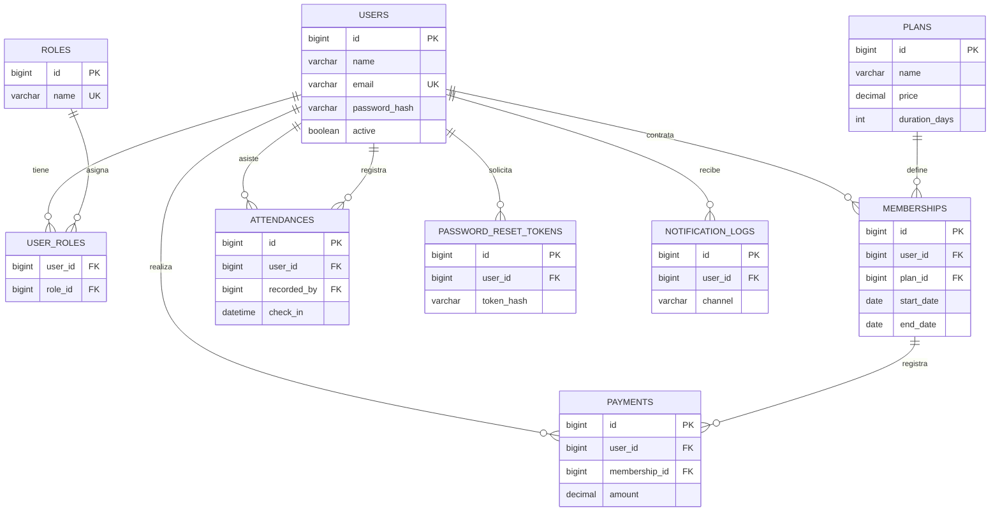

# IRON GYM — Proyecto integrador de Programación Web

**Tecnologías:** React 19, Vite 6, Axios, React Router, Java 21, Spring Boot 3.4, Spring Security, JWT, JPA/Hibernate, Flyway y **MySQL 8**.

**Materia:** Programación Web · **Docente:** Adelina Martínez · **Fecha límite:** 24 de noviembre de 2026, 23:59.

**Integrantes:** Uriel Eduardo Guzmán Ramírez y Carlos Enrique García Unda (verificar datos y número de equipo antes de entregar).

**Guía para estudiar el código ordenado:** `docs/GUIA_PARA_ENTENDER_EL_CODIGO.md`.

**Prototipo Figma:** https://www.figma.com/design/wbdc45yrgm1ps89ch9Cvkc

**API local:** `http://localhost:8080/api` · **Frontend local:** `http://localhost:5173`

**URL HTTPS en VPS:** pendiente de desplegar. **GitHub Projects público:** pendiente de crear. **Repositorio público:** pendiente de publicar.

## 1. Qué hace IRON GYM

Sistema para la administración de un gimnasio. Un **administrador** gestiona usuarios, roles, socios, planes, membresías, cobros y asistencias. Un **entrenador** consulta socios y registra asistencias, pero no realiza cobros. Un **socio** se registra e inicia sesión para consultar exclusivamente su membresía, sus pagos, sus asistencias y su perfil.

El registro público siempre crea un **SOCIO**. No permite seleccionar administrador ni entrenador. Los roles se controlan en Spring Security y en la relación `user_roles` de MySQL. Las contraseñas se almacenan en **BCrypt**; JWT se transmite con `Authorization: Bearer` y puede revocarse al cerrar sesión.

## Código organizado para VS Code

- Archivos React/JSX, Java y CSS formateados con saltos de línea y sangría uniforme.
- `pages/Management.jsx` separado por secciones con explicaciones del CRUD, permisos, formularios, tablas y modales.
- `components/UI.jsx`, `pages/AuthPage.jsx`, `App.jsx` y `config/SecurityConfig.java` reestructurados para facilitar su lectura.
- `.editorconfig` y `frontend/.prettierrc.json` permiten mantener el mismo estilo al trabajar en equipo.
- La estructura `mx/edu/ito/irongym` es el **paquete Java**; debe conservarse.

## 2. Estructura del proyecto

```text
IRON_GYM/
├── frontend/               React + Vite (pantallas, validaciones y API)
│   ├── src/pages/          Pantallas de Figma traducidas a React
│   ├── src/components/     Navbar, modal, formulario, tabla y paginación
│   ├── src/services/api.js Axios con token JWT y errores de red
│   └── public/gym-hero.svg Imagen vectorial de fondo, reemplazable por la original
├── backend/                Java + Spring Boot
│   ├── pom.xml             Dependencias Maven
│   └── src/main/
│       ├── java/          controller → service → repo → model
│       └── resources/
│           ├── application.properties.example
│           └── db/migration/ (Flyway)
├── database/
│   ├── respaldo_irongym.sql  Respaldo de referencia (estructura + datos de ejemplo)
│   └── generar_seed.py      Generador de datos de prueba ya generados
├── docs/                  Guía técnica y pendientes de la entrega
└── README.md
```

## 3. Requisitos en tu computadora

1. **Java JDK 21** (`java -version`).
2. **Maven 3.9 o superior** (`mvn -version`).
3. **Node.js 20 o superior** (`node -v`) y npm (`npm -v`).
4. **MySQL Server 8.0+**, con usuario y contraseña que conozcas. **No usar MariaDB**.
5. **Visual Studio Code**, con extensiones *Extension Pack for Java* y *Spring Boot Extension Pack*.

No vuelvas a ejecutar `npm create vite` ni copies archivos de ZIP antiguos. **Este ZIP es un proyecto autónomo**, con `package.json`, `index.html`, `vite.config.js`, código Java, migraciones y recursos gráficos.

## 4. Ejecutar paso por paso en Windows / PowerShell

### Paso A — Descomprimir y abrir

Descomprime `IRON_GYM_CODIGO_ORDENADO.zip` en la carpeta deseada, por ejemplo `C:\Proyectos\IRON_GYM`. En VS Code usa **Archivo → Abrir carpeta** y selecciona **IRON_GYM** (la carpeta que contiene `frontend`, `backend` y este README).

Abre **Terminal → Nueva terminal**. Las rutas siguientes son relativas a la raíz del proyecto, por lo que no necesitas escribir tu ruta personal.

### Paso B — MySQL

Inicia el servicio **MySQL80** (puede llamarse distinto):

```powershell
Get-Service *mysql*
Start-Service MySQL80
```

Si ya está ejecutándose, no necesitas arrancarlo. En MySQL Workbench, o desde la terminal de MySQL, ejecuta **solamente**:

```sql
CREATE DATABASE IF NOT EXISTS iron_gym CHARACTER SET utf8mb4 COLLATE utf8mb4_unicode_ci;
```

**No crees tablas a mano.** Flyway ejecutará automáticamente `V1__schema.sql` y `V2__seed.sql` al iniciar Spring Boot por primera vez.

### Paso C — Configurar y ejecutar backend

Abre **una terminal** en VS Code y ejecuta:

```powershell
cd backend
Copy-Item "src\main\resources\application.properties.example" "src\main\resources\application.properties"
```

En **esa misma terminal**, configura la clave de MySQL y genera un secreto JWT aleatorio (solo se conservan durante esa sesión PowerShell):

```powershell
$env:DB_USER = "root"
$env:DB_PASSWORD = "TU_CONTRASEÑA_REAL_DE_MYSQL"
$bytes = New-Object byte[] 48
$rng = [System.Security.Cryptography.RandomNumberGenerator]::Create()
$rng.GetBytes($bytes)
$env:JWT_SECRET_BASE64 = [Convert]::ToBase64String($bytes)
```

> Para demostrar el logout es conveniente mantener el mismo secreto JWT mientras dure la sesión. En VPS debe conservarse de manera segura y persistente. **No pegues tus contraseñas reales en GitHub, capturas ni archivos públicos.**

Inicia Spring Boot:

```powershell
mvn spring-boot:run
```

Cuando termine de arrancar, comprueba en tu navegador: **http://localhost:8080/api/health**. Debe devolver `{"service":"IRON GYM","status":"UP"}`.

Si no funciona, verifica primero que MySQL está encendido, la base se llama `iron_gym`, el usuario/contraseña son correctos y que 8080 no está ocupado.

### Paso D — Configurar y ejecutar frontend

Abre **otra terminal** de VS Code, desde la raíz `IRON_GYM`, y ejecuta:

```powershell
cd frontend
Copy-Item .env.example .env
npm install
npm run dev
```

Abre **http://localhost:5173**. React consultará la API en `http://localhost:8080/api`, no un servicio falso.

Si la terminal inicia dentro de `backend`, primero usa `cd ..` y luego `cd frontend`. **Mantén las dos terminales abiertas** mientras pruebas.

### Paso E — Pruebas rápidas

En la pantalla de acceso, usa las cuentas precargadas de la sección 5. Repite la prueba con cada rol para verificar que sus menús cambian. Como administrador, agrega un socio; después registra su membresía y un pago. Como entrenador, registra su asistencia. Como socio, inicia sesión y comprueba que **solo ves tu información**.

En MySQL Workbench puedes comprobar los datos con:

```sql
USE iron_gym;
SHOW TABLES;
SELECT id, name, email, active FROM users;
SELECT id, user_id, plan_id, end_date, status FROM memberships;
SELECT id, user_id, amount, method FROM payments ORDER BY id DESC LIMIT 10;
SELECT * FROM flyway_schema_history;
```

La consulta `flyway_schema_history` debe contener las migraciones aplicadas.

## 5. Credenciales para evaluación LOCAL (datos de ejemplo)

| Rol | Correo | Contraseña |
|---|---|---|
| **ADMIN** | `admin@irongym.local` | `Admin123!` |
| **ENTRENADOR** | `coach@irongym.local` | `Coach123!` |
| **SOCIO** | `ana.lopez@irongym.local` | `Socio123!` |

**Muy importante:** estas cuentas son exclusivamente de demostración, las contraseñas se almacenan **hasheadas con BCrypt en MySQL**, no como texto plano en las tablas. Antes del despliegue público cambia las claves y evita cuentas de evaluación con permisos reales sobre datos sensibles. El administrador inicial se incluye para que el profesor pueda revisar todos los módulos en un entorno preparado para la evaluación.

## 6. Diagrama Entidad–Relación



La relación **USERS ↔ ROLES es N:M** mediante `user_roles`. Incluimos *10 tablas de negocio y seguridad*, además de la tabla `flyway_schema_history` que crea Flyway.

## 7. Datos y migraciones

- `V1__schema.sql`: estructura, índices y claves foráneas. **Nunca se generan tablas con `ddl-auto=create`**, se usa `ddl-auto=validate`.
- `V2__seed.sql`: 17 usuarios (15 socios + 1 entrenador + 1 administrador), 3 roles, 3 planes, 15 membresías, 30 pagos y 48 asistencias. Fechas relativas a la fecha de instalación.
- `database/respaldo_irongym.sql`: respaldo de referencia con estructura y los mismos datos. **No importarlo si Flyway ya ejecutó las migraciones**, o provocará datos duplicados.
- Para generar un dump real de tu base activa, ejecutar posteriormente: `mysqldump -u root -p iron_gym > respaldo_real.sql` (no publicar datos personales reales).

## 8. Endpoints principales de la API

| Método | Ruta | Permisos |
|---|---|---|
| `GET` | `/api/health` | Público |
| `POST` | `/api/auth/register` | Público, crea SOCIO |
| `POST` | `/api/auth/login` | Público |
| `POST` | `/api/auth/logout` | Sesión válida, revoca JWT |
| `POST` | `/api/auth/forgot-password` | Público, requiere Postfix configurado |
| `POST` | `/api/auth/reset-password` | Público, token de recuperación válido |
| `GET` | `/api/auth/me` | Autenticado |
| `GET/POST/PUT/DELETE` | `/api/users` | ADMIN para modificar; entrenador solo lista |
| `PUT` | `/api/users/{id}/roles` | ADMIN |
| `GET/PUT` | `/api/users/me` | Cada persona modifica solo su perfil permitido |
| `GET/POST/PUT/DELETE` | `/api/plans` | Lista paginada; todos pueden consultar; ADMIN modifica |
| `GET` | `/api/plans/options` | Planes activos para selector |
| `GET/POST/PUT/DELETE` | `/api/memberships` | ADMIN |
| `GET` | `/api/memberships/mine` | SOCIO, datos propios |
| `GET/POST/PUT/DELETE` | `/api/payments` | ADMIN |
| `GET` | `/api/payments/mine` | SOCIO, datos propios |
| `GET/POST` | `/api/attendances` | ADMIN o ENTRENADOR; PUT/DELETE solo ADMIN |
| `GET` | `/api/attendances/mine` | SOCIO, datos propios |
| `GET` | `/api/dashboard/admin` | ADMIN |
| `GET` | `/api/dashboard/trainer` | ENTRENADOR |
| `GET` | `/api/dashboard/member` | SOCIO |
| `POST` | `/api/memberships/{id}/notify?channel=EMAIL` | ADMIN; canal EMAIL, SMS o WHATSAPP |

Listas principales: **paginación en servidor**, ej. `GET /api/users?q=ana&role=SOCIO&page=0&size=10`, con respuesta `{content, totalElements, totalPages, number, size}`. El frontend no descarga todo para paginar localmente.

**JWT:** agrega `Authorization: Bearer TU_TOKEN` en rutas privadas. Ejemplo PowerShell:

```powershell
$login = Invoke-RestMethod -Method Post -Uri 'http://localhost:8080/api/auth/login' -ContentType 'application/json' -Body '{"email":"admin@irongym.local","password":"Admin123!"}'
$token = $login.token
Invoke-RestMethod -Uri 'http://localhost:8080/api/dashboard/admin' -Headers @{Authorization="Bearer $token"}
```

## 9. Comunicación con usuario — qué está preparado y qué falta

**Código listo:** recuperación de contraseña con token temporal hasheado y correo desde `JavaMailSender`; avisos de vencimiento por correo, SMS y WhatsApp activados mediante el botón **Avisar** en mensualidades. Las peticiones Twilio se realizan **desde Spring Boot** y nunca desde el teléfono del operador. Se guarda un log de envíos exitosos en MySQL.

**Pendiente de infraestructura real:** instalar Postfix en el VPS, configurar dominio, SPF, DKIM y reputación/salida SMTP; autorizar números y configurar credenciales Twilio o WhatsApp. No se incluyen claves reales; por defecto los canales están deshabilitados y **devuelven error 422** al intentar enviar, en vez de fingir que enviaron. El correo de recuperación también requerirá que el servidor de correo esté configurado y habilitado.

Variables en `.properties` (tomadas del entorno): `MAIL_ENABLED`, `MAIL_FROM`, `MAIL_HOST`, `MAIL_PORT`, `TWILIO_ENABLED`, `TWILIO_ACCOUNT_SID`, `TWILIO_AUTH_TOKEN`, `TWILIO_SMS_FROM`, `TWILIO_WHATSAPP_FROM`.

El proveedor Twilio requiere crédito/sandbox y consentimientos de destino; el SMS y WhatsApp deben utilizar números internacionales tipo `+52...`. Para WhatsApp debes tener remitente autorizado o sandbox aprobado.

## 10. Seguridad y control de acceso

- Spring Security con filtros JWT; permisos por `@PreAuthorize` en controllers y rutas protegidas React.
- BCrypt para contraseñas. Tokens de logout y recuperación almacenados como SHA-256, nunca en texto plano.
- Errores JSON con códigos 400, 401, 403, 404, 422, 500 y errores por campo (`fieldErrors`).
- Secretos solamente en variables de entorno o `application.properties` local **ignorados por Git**. Solo `application.properties.example` sin contraseñas reales pertenece al repo.
- La sesión React usa `sessionStorage` para persistir JWT al refrescar, pero frente a XSS es menos segura que una cookie HttpOnly; para producción debe reforzarse CSP y el tratamiento de tokens.
- Los perfiles socio (`/mine`) recuperan ID desde el usuario autenticado, **nunca** desde un parámetro `userId` introducido por el cliente.
- Borrado de socios = desactivar; borrado de membresías = cancelar; borrado de planes = desactivar para conservar historial.

## 11. Correspondencia de Figma con React

| Figma | React |
|---|---|
| Acceso, registro y recuperación | `AuthPage.jsx` |
| Dashboard por rol | `Dashboard.jsx` |
| Socios | `SociosPage.jsx` |
| Cobros | `PaymentsPage.jsx` |
| Asistencias | `AttendancesPage.jsx` |
| Mensualidades | `MembershipsPage.jsx` |
| Usuarios y roles | `UsersPage.jsx` |
| Portal del socio | `MyAreaPage.jsx` |
| Perfil | `ProfilePage.jsx` |

**Paleta:** negro grafito `#0D0F13` (solidez y concentración), gris `#1A1D22` (jerarquía visual), naranja `#FC5B28` (energía, fuerza y acciones principales), blanco `#F6F7FA` (legibilidad), verde `#43CE95` (estados correctos). Esta combinación contrasta acciones y estados sin añadir complejidad al CRUD.

**Logo:** símbolo original vectorial de mancuerna + nombre IRON GYM en React (Lucide) y tipografía. **Imagen del login:** ilustración SVG original incluida para que el ZIP funcione sin imágenes perdidas; puede sustituirse por la fotografía aprobada en Figma para conseguir una coincidencia visual más exacta.

## 12. Qué queda para la entrega REAL

**Este ZIP es la base funcional de código, no una entrega final ya probada en VPS.** Aún necesitan:

1. Configurar MySQL real y comprobar cada flujo en sus computadoras. Ajustar problemas detectados en la ejecución.
2. Probar usuario ADMIN / ENTRENADOR / SOCIO y casos 400/401/403/404/422 con **Bruno**, y versionar la colección (la dejamos para la fase que acordaron).
3. Configurar servicios reales de comunicación (Postfix, SPF, DKIM, SMS, WhatsApp) y demostrar recepción.
4. Publicar repo con **commits reales de ambos integrantes**, README actualizado, GitHub Projects público en columnas Backlog, To Do, In Progress, In Review, Done. Registrar avances reales; no fingir historial.
5. Desplegar **backend JAR con systemd, MySQL y frontend build estático con Nginx/Apache** en el VPS propio del equipo, bajo HTTPS con Certbot.
6. Verificar y documentar URL pública de la aplicación y URL base de la API; realizar demo desde la dirección HTTPS en el día de evaluación.

**Advertencia importante de la rúbrica:** el trabajo generado completamente por IA sin participación propia del equipo puede recibir **cero**. Estudien, modifiquen y prueben realmente los archivos. Lo importante es que ambos puedan explicar los controladores, los servicios, la autenticación, el proceso CRUD, Flyway, JWT, el frontend y el despliegue. Ninguna prueba, despliegue o comunicación real se afirma realizada sin comprobarla.

---

**Guía de estudio recomendada:** empieza por `backend/.../controller/AuthController.java` → `service/AuthService.java` → `repo/UserRepository.java` → `model/User.java` → `db/migration/V1__schema.sql`, y luego sigue `frontend/src/services/api.js` → `context/AuthContext.jsx` → `App.jsx` → `pages/Management.jsx`.
