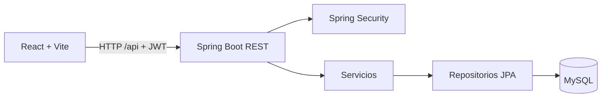
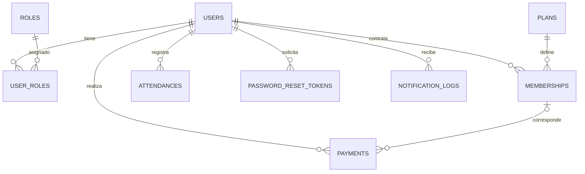

# IRON GYM — Sistema web de gestión de gimnasio

Proyecto integrador de **Programación Web**. Repositorio compartido de **Uriel Eduardo Guzmán Ramírez** (frontend React) y **Carlos Enrique García Unda** (backend Spring Boot / base de datos).

**Repositorio:** https://github.com/CarlosEnriqueGarciaUnda/IronGym-App  
**Figma:** https://www.figma.com/design/wbdc45yrgm1ps89ch9Cvkc  
**Tablero:** https://github.com/users/CarlosEnriqueGarciaUnda/projects/2/views/1

## Descripción

IRON GYM permite a tres tipos de usuario acceder a las operaciones autorizadas de un gimnasio:

| Rol | Funciones principales |
| --- | --- |
| ADMIN | Dashboard, gestión de socios y usuarios, cobros, asistencias, membresías y planes. |
| ENTRENADOR | Dashboard, consulta de socios y registro de asistencias. |
| SOCIO | Consulta de sus propias membresías, pagos, asistencias y perfil. |

El frontend usa rutas protegidas para la experiencia de usuario. **La seguridad real se aplica desde Spring Security** mediante JWT, roles y comprobaciones en los controladores. El registro público asigna exclusivamente el rol `SOCIO`.

## Tecnologías

- **Frontend:** React 19, Vite 6, React Router 7, Axios y lucide-react.
- **Backend:** Java 21, Spring Boot 3.4.3, Spring Security, JWT, JPA y Bean Validation.
- **Base de datos:** MySQL 8 y Flyway. Las relaciones se crean con migraciones, no con `ddl-auto=create`.
- **Arquitectura:** controlador REST → servicio → repositorio JPA → MySQL.



## Estructura

```text
IronGym-App/
├── backend/
│   ├── pom.xml
│   └── src/main/
│       ├── java/mx/edu/ito/irongym/
│       └── resources/db/migration/
│           ├── V1__schema.sql
│           └── V2__seed.sql
├── frontend/
│   ├── src/components/
│   ├── src/context/
│   ├── src/hooks/
│   ├── src/layouts/
│   ├── src/pages/
│   ├── src/routes/
│   └── src/services/
├── docs/
├── scripts/
└── README.md
```

## Ejecutar localmente (Windows / PowerShell)

**Requisitos:** Java 21, Maven, Node.js con npm y MySQL 8. Comprueba con `java -version`, `mvn -version`, `node -v` y `npm -v`. MySQL debe estar iniciado en el puerto 3306.

1. Crear la base **vacía** desde MySQL Workbench (no usar pgAdmin):

```sql
CREATE DATABASE IF NOT EXISTS iron_gym
  CHARACTER SET utf8mb4 COLLATE utf8mb4_unicode_ci;
```

2. En una terminal abierta en la **raíz** del repositorio, iniciar Spring Boot:

```powershell
cd backend
Copy-Item src\main\resources\application.properties.example src\main\resources\application.properties -ErrorAction SilentlyContinue
$env:DB_USER = 'root'
$env:DB_PASSWORD = 'TU_CONTRASENA_DE_MYSQL'
$bytes = New-Object byte[] 48
$rng = [System.Security.Cryptography.RandomNumberGenerator]::Create()
$rng.GetBytes($bytes)
$rng.Dispose()
$env:JWT_SECRET_BASE64 = [Convert]::ToBase64String($bytes)
mvn spring-boot:run
```

Sustituye la contraseña; **no la publiques en GitHub**. Guarda la clave JWT de forma privada y reutilízala cuando reinicies la API; al cambiarla, los tokens anteriores dejan de ser válidos. En el primer arranque, Flyway ejecuta `V1__schema.sql` y `V2__seed.sql` una sola vez.

3. En una **segunda terminal** desde la raíz, iniciar React:

```powershell
cd frontend
Copy-Item .env.example .env -Force
npm install
npm run build
npm run dev
```

Frontend: http://localhost:5173/login  
API: http://localhost:8080/api/health

**Importante:** React puede mostrar el login aunque MySQL/Spring Boot estén apagados, pero no autenticar usuarios reales.

## Cuentas iniciales para evaluación local

Únicamente para una base nueva de desarrollo, creadas por `V2__seed.sql` con BCrypt:

| Rol | Correo | Contraseña local |
| --- | --- | --- |
| ADMIN | `admin@irongym.local` | `Admin123!` |
| ENTRENADOR | `coach@irongym.local` | `Coach123!` |
| SOCIO | `ana.lopez@irongym.local` | `Socio123!` |

No utilizar estas contraseñas en un servidor público. Cambiarlas antes de desplegar en VPS, especialmente la cuenta administradora.

## Diagrama entidad–relación



Tablas adicionales: `revoked_tokens` para invalidación JWT; `attendances.recorded_by` también referencia a `users`. La relación **usuarios ↔ roles** es muchos a muchos a través de `user_roles`.

## Endpoints principales

| Método | Ruta | Permiso |
| --- | --- | --- |
| POST | `/api/auth/login` | Público |
| POST | `/api/auth/register` | Público; crea SOCIO |
| GET | `/api/auth/me` | Autenticado |
| POST | `/api/auth/logout` | Autenticado |
| GET | `/api/dashboard/admin` | ADMIN |
| GET | `/api/dashboard/trainer` | ENTRENADOR |
| GET | `/api/dashboard/member` | SOCIO |
| GET / POST / PUT / DELETE | `/api/users` | Según operación: ADMIN y consulta ENTRENADOR |
| GET / POST / PUT / DELETE | `/api/payments` | ADMIN |
| GET / POST / PUT / DELETE | `/api/attendances` | Según operación: ADMIN / ENTRENADOR |
| GET / POST / PUT / DELETE | `/api/memberships` | ADMIN |
| GET | `/api/payments/mine`, `/api/memberships/mine`, `/api/attendances/mine` | SOCIO |

Las colecciones paginadas aceptan `page`, `size` y, cuando aplica, `q` desde Spring Data; la UI no pagina exclusivamente en el navegador.

## Pruebas, alcance y pendientes

Consulta [docs/INTEGRACION_Y_PRUEBAS.md](docs/INTEGRACION_Y_PRUEBAS.md). Incluye pruebas de autenticación, roles, navegación, paginación, formularios, registro de socios y persistencia.

Puedes ejecutar las pruebas HTTP sin modificar datos desde PowerShell con [scripts/probar-api.ps1](scripts/probar-api.ps1). **No se considera verificado un caso hasta ejecutarlo y registrar el resultado real.**

**Preparado en código, pero condicionado a configuración externa:** correo Postfix, SMS y WhatsApp. **Pendiente fuera de esta fase:** colección Bruno y despliegue real VPS/HTTPS, URLs definitivas y pruebas sobre servidor. No colocar secretos en Git.

## Colaboración GitHub

- Carlos: rama `feat/backend-core`.
- Uriel: rama `feat/frontend-ui` e Issues #5 a #8.
- Crear `main` a partir de backend antes del Pull Request, si todavía no existe; fusionar después los cambios revisados del frontend.
- Cada integrante mantiene sus commits, issues y evidencias de las pruebas ejecutadas.

*Proyecto académico. Este README describe la implementación y cómo verificarla; no garantiza que todos los servicios externos estén configurados.*


## Despliegue en Producción (VPS Azure con HTTPS)

- **URL de producción:** https://irongym-ito-2026.northcentralus.cloudapp.azure.com
- **Servidor:** Ubuntu Server en Microsoft Azure (`vps-act8-eq17`)
- **Proxy Inverso y SSL:** Nginx + Certbot (Let's Encrypt)
  - `/` sirve el compilado estático de React (`dist/` en `/var/www/html`).
  - `/api/` redirige peticiones hacia el backend Spring Boot en `http://127.0.0.1:8093/api/`.
- **Backend:** Java 17 / Spring Boot 3 ejecutándose como servicio `systemd` (`irongym.service`) en el puerto `8093`.
- **Base de Datos:** MySQL 8 (`iron_gym`) con migraciones automáticas gestionadas por Flyway.

### Comandos de mantenimiento en el servidor
- Reiniciar backend: `sudo systemctl restart irongym`
- Ver logs en tiempo real: `sudo journalctl -u irongym -f`
- Recargar Nginx: `sudo nginx -t && sudo systemctl reload nginx`