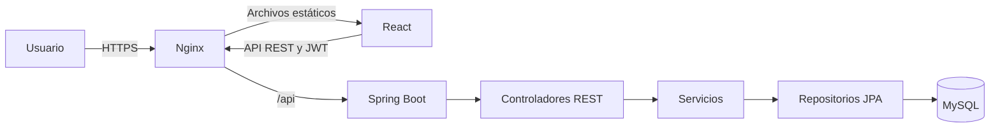
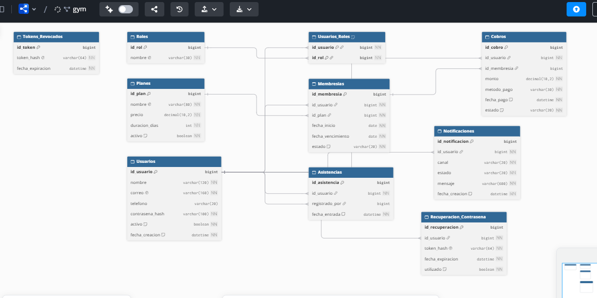
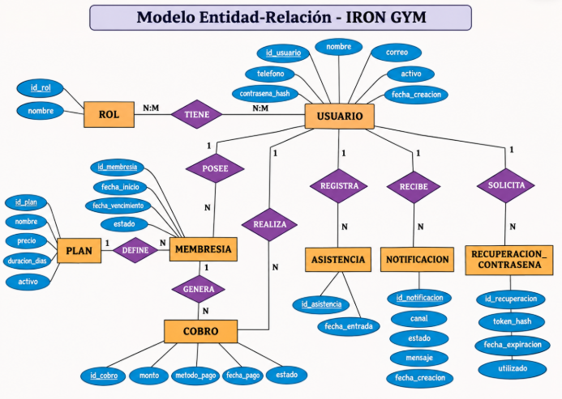

# IRON GYM | Sistema web de gestión de gimnasio

**Instituto Tecnológico de Oaxaca**  
**Carrera:** Ingeniería en Sistemas Computacionales  
**Materia:** Programación Web  
**Docente:** Adelina Martínez Nieto  
**Equipo:** 17  
**Integrantes:** Uriel Eduardo Guzmán Ramírez y Carlos Enrique García Unda

## Descripción del proyecto

IRON GYM es una aplicación web que desarrollamos para administrar los procesos de un gimnasio. Permite registrar socios, asignar planes de entrenamiento, controlar la vigencia de las membresías, registrar cobros y consultar las asistencias desde un mismo sistema.

El proyecto se divide en un frontend desarrollado con React, una API REST con Spring Boot y una base de datos MySQL. Cada usuario tiene acceso a las funciones que corresponden a su rol. El sistema está desplegado en un VPS de Microsoft Azure y se puede utilizar desde un navegador mediante HTTPS.

## Enlaces del proyecto

| Recurso | Enlace |
| --- | --- |
| Aplicación web | [IRON GYM](https://irongym-ito-2026.northcentralus.cloudapp.azure.com) |
| URL base de la API | https://irongym-ito-2026.northcentralus.cloudapp.azure.com/api |
| Estado de la API | [Health](https://irongym-ito-2026.northcentralus.cloudapp.azure.com/api/health) |
| Repositorio | [GitHub](https://github.com/CarlosEnriqueGarciaUnda/IronGym-App) |
| Prototipo | [Figma](https://www.figma.com/proto/qjRAeBtUIrIMoGZC0J37OD/gym?node-id=31-1626&p=f&t=dtR3VwxA60eoD40j-0&scaling=scale-down&content-scaling=fixed&page-id=0%3A1) |
| Organización de actividades | [GitHub Projects](https://github.com/users/CarlosEnriqueGarciaUnda/projects/2/views/1) |
| Colección de pruebas | [Bruno](bruno/) |

## Módulos y niveles de acceso

| Rol | Funciones |
| --- | --- |
| ADMIN | Panel administrativo, gestión de usuarios y socios, planes, mensualidades, cobros y asistencias. |
| ENTRENADOR | Panel del entrenador, consulta de socios y registro y consulta de asistencias. |
| SOCIO | Consulta de sus propias membresías, pagos, asistencias y perfil. |


### Cuentas de demostración

Las migraciones incluyen una cuenta inicial por cada rol:

| Rol | Correo |
| --- | --- |
| ADMIN | `admin@irongym.local` |
| ENTRENADOR | `coach@irongym.local` |
| SOCIO | `ana.lopez@irongym.local` |


## Tecnologías utilizadas

| Componente | Tecnología |
| --- | --- |
| Frontend | React 19, Vite 6, React Router y Axios |
| Backend | Java 21 (versión objetivo del proyecto), Spring Boot 3.4.3 y Maven |
| Seguridad | Spring Security, JWT y BCrypt |
| Persistencia | MySQL 8, Spring Data JPA, Hibernate y Flyway |
| Validaciones | Bean Validation y validaciones de formularios en React |
| Diseño | Figma, CSS y Lucide React |
| Pruebas de API | Bruno |
| Despliegue | Ubuntu Server, Microsoft Azure, Nginx, systemd y HTTPS con Let's Encrypt |
| Control de versiones | Git y GitHub |

## Arquitectura



React se encarga de presentar la información y capturar los datos de los formularios. Spring Boot recibe las peticiones, verifica la autenticación y los permisos, valida los datos y ejecuta las operaciones correspondientes. MySQL conserva los registros del gimnasio. Nginx sirve el frontend y redirige las peticiones de la API al backend.

## Base de datos

La base de datos `iron_gym` se administra mediante Flyway. La migración `V1__schema.sql` crea las tablas y sus relaciones, mientras que `V2__seed.sql` carga los datos de demostración. Hibernate utiliza `ddl-auto=validate` para comprobar que el modelo coincide con el esquema, en lugar de generar las tablas automáticamente.

### Diagrama entidad-relación





### Respaldo SQL

El respaldo independiente de demostración está pendiente de incorporarse al repositorio. Para obtenerlo, se puede inicializar una base local limpia mediante Flyway y exportarla con `mysqldump`. El respaldo debe contener únicamente los datos de demostración, sin datos personales ni credenciales de producción. No se debe restaurar sobre la base del VPS.

Ejemplo de exportación desde una base local de demostración ya inicializada:

```powershell
mysqldump -u root -p --single-transaction --no-tablespaces --result-file=iron_gym_backup.sql iron_gym
```


## Instalación local

### Requisitos

- Git, JDK 21, Maven o Maven Wrapper.
- Node.js 20 y npm.
- MySQL 8.
- Bruno para las pruebas de la API.

### 1. Clonar el repositorio

```powershell
git clone https://github.com/CarlosEnriqueGarciaUnda/IronGym-App.git
cd IronGym-App
```

### 2. Preparar MySQL

Crear una base de datos vacía desde el cliente MySQL local:

```sql
CREATE DATABASE IF NOT EXISTS iron_gym CHARACTER SET utf8mb4 COLLATE utf8mb4_unicode_ci;
```

No es necesario crear las tablas manualmente. Flyway lo realiza al iniciar el backend.

### 3. Iniciar el backend en Windows

Desde PowerShell, en el directorio del proyecto:

```powershell
cd backend
Copy-Item src/main/resources/application.properties.example src/main/resources/application.properties
$env:DB_USER = "root"
$clave = Read-Host "Contraseña de MySQL local" -AsSecureString
$env:DB_PASSWORD = [System.Net.NetworkCredential]::new("", $clave).Password
$bytes = New-Object byte[] 48; $rng = [System.Security.Cryptography.RandomNumberGenerator]::Create(); $rng.GetBytes($bytes); $env:JWT_SECRET_BASE64 = [Convert]::ToBase64String($bytes); $rng.Dispose()
.\mvnw.cmd spring-boot:run
```

Si ya existe `application.properties`, conservarlo y revisar sus variables antes de copiar la plantilla. La configuración de ejemplo utiliza el puerto 8080 y MySQL en `localhost:3306`. En Linux se puede utilizar Maven instalado (`mvn spring-boot:run`) con las variables de entorno correspondientes. La clave JWT debe permanecer privada; en producción se conserva una clave estable.

### 4. Iniciar el frontend

Abrir otra terminal desde la raíz del proyecto:

```powershell
cd frontend
npm ci
$env:VITE_API_URL = "/api"
npm run dev
```

- Frontend local: http://localhost:5173
- API local: http://localhost:8080/api
- Estado de la API: http://localhost:8080/api/health

Vite utiliza un proxy de desarrollo para dirigir las peticiones `/api` al backend local. Los archivos de configuración privada y las dependencias generadas no deben subirse al repositorio.

## API REST

Las siguientes rutas se expresan de forma relativa a la URL base de la API (`/api`). Las peticiones protegidas utilizan la cabecera `Authorization: Bearer <JWT>`.

| Método | Ruta | Función / permisos |
| --- | --- | --- |
| GET | `/health` | Estado del servicio, público |
| POST | `/auth/login` | Iniciar sesión y obtener JWT |
| POST | `/auth/register` | Registro público de socio |
| GET | `/auth/me` | Consultar sesión actual |
| POST | `/auth/logout` | Cerrar sesión e invalidar JWT |
| POST | `/auth/forgot-password`, `/auth/reset-password` | Recuperación de contraseña; depende del correo configurado |
| GET | `/dashboard/admin`, `/dashboard/trainer`, `/dashboard/member` | Panel correspondiente al rol |
| GET | `/users` | Consultar usuarios: ADMIN / ENTRENADOR |
| POST, PUT, DELETE | `/users`, `/users/{id}` | Crear, actualizar y desactivar usuarios: ADMIN |
| PUT | `/users/{id}/roles` | Gestionar roles: ADMIN |
| GET, PUT | `/users/me` | Consultar y actualizar perfil propio |
| GET | `/plans`, `/plans/options` | Consultar planes: autenticado |
| POST, PUT, DELETE | `/plans`, `/plans/{id}` | Gestión de planes: ADMIN |
| GET, POST, PUT, DELETE | `/memberships`, `/memberships/{id}` | Gestión de membresías: ADMIN |
| GET, POST, PUT, DELETE | `/payments`, `/payments/{id}` | Gestión de cobros: ADMIN |
| GET, POST, PUT, DELETE | `/attendances`, `/attendances/{id}` | ADMIN; ENTRENADOR solo consulta y registro |
| GET | `/memberships/mine`, `/payments/mine`, `/attendances/mine` | Registros propios: SOCIO |
| POST | `/memberships/{id}/notify?channel=WHATSAPP` | Aviso de membresía: ADMIN; requiere proveedor habilitado |


## Pruebas de la API con Bruno

La carpeta [bruno/](bruno/) contiene la colección de peticiones. Para utilizar la colección optimizada de 19 peticiones, abrirla en Bruno y seleccionar el entorno `Produccion`. El entorno `Local` permite realizar pruebas contra la API del equipo de desarrollo.


| Prueba | Resultado esperado |
| --- | --- |
| Estado de la API | 200 OK |
| Login con credenciales correctas | 200 OK y JWT |
| Consultar usuarios con ADMIN | 200 OK |
| Acceder sin JWT | 401 Unauthorized |
| Consultar usuarios con SOCIO | 403 Forbidden |
| Registro con campos inválidos | 400 Bad Request |
| Registro y actualización de un socio de prueba | 200 OK |
| Registro de mensualidad, cobro y asistencia | 200 OK |
| Baja de registros de demostración y logout | 200 OK |


## Organización del equipo

Utilizamos Git y GitHub para llevar el historial de cambios y un tablero de GitHub Projects para organizar las actividades del desarrollo.

| Integrante | Aportación principal |
| --- | --- |
| Uriel Eduardo Guzmán Ramírez | Diseño de interfaz, frontend React, componentes, rutas, integración con la API, pruebas y actualización del frontend en el VPS. |
| Carlos Enrique García Unda | Base de datos, migraciones Flyway, backend Spring Boot, seguridad JWT y configuración inicial del despliegue. |

Las ramas de trabajo son `feat/frontend-ui` y `feat/backend-core`. La rama `main` concentra los cambios integrados.
